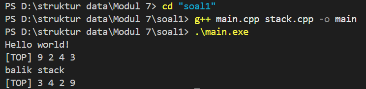
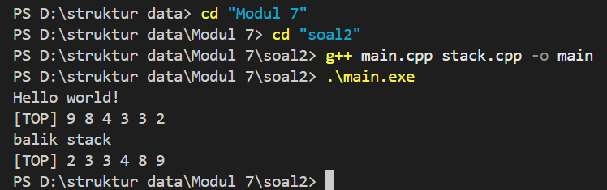
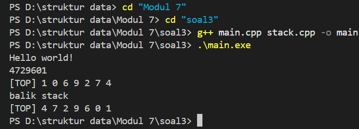

# <h1 align="center">Laporan Praktikum Modul 7 - Stack</h1>
<p align="center">Shafira Shifa Azahra - 109082500125</p>

## Dasar Teori

Stack atau tumpukan adalah salah satu bentuk struktur data yang prinsip kerjanya seperti tumpukan benda, yaitu elemen yang dapat diambil lebih dahulu adalah elemen yang berada paling atas. Prinsip ini disebut LIFO (*Last In First Out*), yaitu elemen yang terakhir masuk akan menjadi elemen yang pertama keluar [1]. Pada stack, akses data hanya dapat dilakukan pada satu ujung saja yang disebut **Top** [1].

### A. Konsep dan Operasi Dasar Stack<br/>
Stack memiliki dua operasi utama, yaitu penyisipan (*push*) dan pengambilan (*pop*) elemen [1]. Selain itu terdapat primitif-primitif pendukung seperti `createStack()` untuk membentuk stack kosong, `isEmpty()` untuk memeriksa apakah stack kosong, serta fungsi lain seperti menampilkan seluruh isi stack [1].
#### 1. Push
*Push* adalah operasi menyisipkan elemen baru ke bagian atas stack. Pada representasi tabel (array), push dilakukan dengan menaikkan nilai Top (`Top = Top + 1`) kemudian menyimpan data pada posisi Top yang baru [1].
#### 2. Pop
*Pop* adalah operasi mengambil elemen yang berada pada posisi Top. Setelah data diambil, nilai Top diturunkan (`Top = Top - 1`) sehingga elemen di bawahnya menjadi Top yang baru [1].
#### 3. Primitif Stack
Primitif pada stack lebih sedikit dibandingkan list lain karena operasi hanya dilakukan pada elemen paling atas. Primitif tersebut antara lain `createStack()`, `isEmpty()`, dan fungsi pencarian atau fungsi pendukung lainnya [1].

### B. Representasi Stack<br/>
Stack dapat direpresentasikan dengan dua cara, yaitu menggunakan *pointer* (linked list) dan menggunakan tabel (array) [1].
#### 1. Representasi Pointer
Pada representasi pointer, elemen stack saling terhubung melalui pointer `next` dan stack hanya menyimpan pointer `Top` yang menunjuk elemen paling atas. Jumlah elemen tidak dibatasi karena memori dialokasikan secara dinamis [1].
#### 2. Representasi Tabel (Array)
Pada representasi tabel, stack menggunakan array berindeks dengan jumlah tumpukan yang terbatas (`Imax`). Stack dianggap kosong jika `Top = 0` (atau `-1` bila indeks array dimulai dari 0), dan penuh jika Top mencapai `Imax` [1]. Representasi ini tidak memerlukan manajemen memori sehingga implementasinya lebih sederhana [1].
#### 3. ADT Stack
*Abstract Data Type* (ADT) stack memisahkan definisi tipe dan prototype primitif pada file header (`.h`) dengan implementasinya pada file `.cpp`, sehingga program utama (`main.cpp`) cukup memanggil primitif yang tersedia [1].

## Guided 

### 1. stack.h

```C++
/* file : stack.h
   contoh ADT stack dengan representasi tabel */
#ifndef STACK_H_INCLUDED
#define STACK_H_INCLUDED

#include <iostream>
using namespace std;

struct infotype {
    char nim[20];
    char nama[20];
};
struct Stack {
    infotype info[10];
    int Top;
};

/* prototype */
/******** pengecekan apakah Stack kosong *********/
int isEmpty(Stack S);
/* mengembalikan nilai 0 jika stack kosong */

/******** pembuatan Stack ********/
void createStack(Stack &S);
/* I.S. sembarang
   F.S. terbentuk stack dengan Top=0 */

/******** penambahan elemen pada Stack ********/
void push(Stack &S, infotype X);
/* I.S. Stack mungkin kosong
   F.S. menambahkan elemen pada stack dengan nilai X, TOP=TOP+1 */

/******** penghapusan elemen pada Stack ********/
void pop(Stack &S, infotype &X);
/* I.S. stack tidak kosong
   F.S. nilai info pada indeks TOP disimpan pada X, kemudian TOP=TOP-1 */

/******** proses semua elemen Stack *********/
void viewStack(Stack S);
/* I.S. stack mungkin kosong
   F.S. jika stack tidak kosong menampilkan semua info yang ada pada stack
*/
#endif // STACK_H_INCLUDED
```
File stack.h berisi deklarasi ADT Stack yang menggunakan array. Di dalamnya terdapat infotype yang menyimpan data nim dan nama, serta Stack yang memiliki array info berukuran 10 dan variabel Top. File ini juga berisi deklarasi fungsi seperti isEmpty, createStack, push, pop, dan viewStack. Pada fungsi isEmpty, nilai 0 menandakan bahwa stack dalam keadaan kosong.

### 2. stack.cpp

```C++
#include "stack.h"

int isEmpty(Stack S) {
    /* Top = 0 berarti kosong, sesuai komentar di stack.h dikembalikan 0 */
    if (S.Top == 0) {
        return 0;
    } else {
        return 1;
    }
}

void createStack(Stack &S) {
    S.Top = 0;
}

void push(Stack &S, infotype X) {
    if (S.Top < 10) {
        S.Top = S.Top + 1;
        S.info[S.Top - 1] = X;   /* Top 1..10 dipetakan ke indeks array 0..9 */
    } else {
        cout << "Stack penuh, data tidak bisa ditambahkan" << endl;
    }
}

void pop(Stack &S, infotype &X) {
    if (isEmpty(S) != 0) {
        X = S.info[S.Top - 1];
        S.Top = S.Top - 1;
    } else {
        cout << "Stack kosong, tidak ada data yang bisa diambil" << endl;
    }
}

void viewStack(Stack S) {
    if (isEmpty(S) == 0) {
        cout << "Stack kosong" << endl;
    } else {
        cout << "Isi stack (dari TOP):" << endl;
        for (int i = S.Top; i >= 1; i--) {
            cout << i << ". " << S.info[i - 1].nim << " - "
                 << S.info[i - 1].nama << endl;
        }
    }
}
```
Fungsi createStack digunakan untuk membuat stack kosong dengan mengatur nilai Top = 0. Fungsi push menambahkan data dengan menaikkan nilai Top terlebih dahulu, lalu menyimpan data ke dalam array. Jika stack penuh, akan muncul pesan pemberitahuan. Sementara itu, pop digunakan untuk mengambil data paling atas dan mengurangi nilai Top. Jika stack kosong, akan muncul pesan bahwa tidak ada data yang bisa diambil. Fungsi viewStack menampilkan seluruh isi stack mulai dari elemen paling atas hingga paling bawah.

### 3. main.cpp

```C++
#include <iostream>
#include <cstring>
#include "stack.h"
using namespace std;

int main() {
    Stack S;
    infotype data, hasil;

    createStack(S);
    cout << "Stack baru dibuat, Top = " << S.Top << endl;
    viewStack(S);

    cout << endl << "--- Push 3 data ---" << endl;
    strcpy(data.nim, "103112400001");
    strcpy(data.nama, "Andi");
    push(S, data);

    strcpy(data.nim, "103112400002");
    strcpy(data.nama, "Budi");
    push(S, data);

    strcpy(data.nim, "103112400003");
    strcpy(data.nama, "Citra");
    push(S, data);
    viewStack(S);

    cout << endl << "--- Pop 1 data ---" << endl;
    pop(S, hasil);
    cout << "Data yang diambil: " << hasil.nim << " - " << hasil.nama << endl;
    viewStack(S);

    cout << endl << "--- Pop sampai kosong ---" << endl;
    pop(S, hasil);
    pop(S, hasil);
    pop(S, hasil);
    viewStack(S);

    return 0;
}
```
Program diawali dengan membuat stack kosong, kemudian memasukkan tiga data mahasiswa, yaitu Andi, Budi, dan Citra menggunakan push. Setelah itu, dilakukan pop satu kali sehingga data Citra keluar lebih dulu karena menggunakan prinsip LIFO. Selanjutnya, dilakukan pop sebanyak tiga kali. Karena hanya tersisa dua data, pada pop ketiga akan muncul pesan bahwa stack kosong.

### Output Guided :

```
Stack baru dibuat, Top = 0
Stack kosong

--- Push 3 data ---
Isi stack (dari TOP):
3. 103112400003 - Citra
2. 103112400002 - Budi
1. 103112400001 - Andi

--- Pop 1 data ---
Data yang diambil: 103112400003 - Citra
Isi stack (dari TOP):
2. 103112400002 - Budi
1. 103112400001 - Andi

--- Pop sampai kosong ---
Stack kosong, tidak ada data yang bisa diambil
Stack kosong
```


## Unguided 

### 1. ADT Stack dengan array (createStack, push, pop, printInfo, balikStack)

##### stack.h
```C++
#ifndef STACK_H
#define STACK_H

typedef int infotype;

struct Stack {
    infotype info[20];
    int top;            // -1 jika stack kosong
};

void createStack(Stack &S);
void push(Stack &S, infotype x);
infotype pop(Stack &S);
void printInfo(Stack S);
void balikStack(Stack &S);

#endif
```

##### stack.cpp
```C++
#include <iostream>
#include "stack.h"
using namespace std;

void createStack(Stack &S) {
    S.top = -1;
}

void push(Stack &S, infotype x) {
    if (S.top < 19) {
        S.top++;
        S.info[S.top] = x;
    } else {
        cout << "Stack penuh!" << endl;
    }
}

infotype pop(Stack &S) {
    if (S.top >= 0) {
        infotype t = S.info[S.top];
        S.top--;
        return t;
    }
    cout << "Stack kosong!" << endl;
    return -1;
}

void printInfo(Stack S) {
    cout << "[TOP] ";
    for (int i = S.top; i >= 0; i--) {
        cout << S.info[i] << " ";
    }
    cout << endl;
}

void balikStack(Stack &S) {
    Stack A, B;
    createStack(A);
    createStack(B);
    while (S.top >= 0) push(A, pop(S));
    while (A.top >= 0) push(B, pop(A));
    while (B.top >= 0) push(S, pop(B));
}
```

##### main.cpp
```C++
#include <iostream>
#include "stack.h"
using namespace std;

int main() {
    cout << "Hello world!" << endl;
    Stack S;
    createStack(S);
    push(S, 3);
    push(S, 4);
    push(S, 8);
    pop(S);
    push(S, 2);
    push(S, 3);
    pop(S);
    push(S, 9);
    printInfo(S);
    cout << "balik stack" << endl;
    balikStack(S);
    printInfo(S);
    return 0;
}
```
### Output Unguided 1 :

##### Output 1
```
Hello world!
[TOP] 9 2 4 3 
balik stack
[TOP] 3 4 2 9 
```


Program ini menggunakan ADT Stack dengan array berukuran 20 dan nilai top awal -1 saat stack kosong. Pada bagian main, dilakukan beberapa operasi push dan pop hingga isi stack dari bawah ke atas menjadi 3, 4, 2, dan 9. Fungsi printInfo menampilkan isi stack dari atas, yaitu [TOP] 9 2 4 3. Selanjutnya, prosedur balikStack membalik urutan isi stack menggunakan dua stack bantuan, sehingga hasil akhirnya menjadi [TOP] 3 4 2 9.

### 2. Prosedur pushAscending

##### stack.h
```C++
#ifndef STACK_H
#define STACK_H

typedef int infotype;

struct Stack {
    infotype info[20];
    int top;            // -1 jika stack kosong
};

void createStack(Stack &S);
void push(Stack &S, infotype x);
infotype pop(Stack &S);
void printInfo(Stack S);
void balikStack(Stack &S);

void pushAscending(Stack &S, infotype x);

#endif
```

##### stack.cpp
```C++
#include <iostream>
#include "stack.h"
using namespace std;

void createStack(Stack &S) {
    S.top = -1;
}

void push(Stack &S, infotype x) {
    if (S.top < 19) {
        S.top++;
        S.info[S.top] = x;
    } else {
        cout << "Stack penuh!" << endl;
    }
}

infotype pop(Stack &S) {
    if (S.top >= 0) {
        infotype t = S.info[S.top];
        S.top--;
        return t;
    }
    cout << "Stack kosong!" << endl;
    return -1;
}

void printInfo(Stack S) {
    cout << "[TOP] ";
    for (int i = S.top; i >= 0; i--) {
        cout << S.info[i] << " ";
    }
    cout << endl;
}

void balikStack(Stack &S) {
    Stack A, B;
    createStack(A);
    createStack(B);
    while (S.top >= 0) push(A, pop(S));
    while (A.top >= 0) push(B, pop(A));
    while (B.top >= 0) push(S, pop(B));
}

// elemen terkecil di dasar, terbesar di TOP
void pushAscending(Stack &S, infotype x) {
    Stack temp;
    createStack(temp);
    while (S.top >= 0 && S.info[S.top] > x) {
        push(temp, pop(S));
    }
    push(S, x);
    while (temp.top >= 0) {
        push(S, pop(temp));
    }
}
```

##### main.cpp
```C++
#include <iostream>
#include "stack.h"
using namespace std;

int main() {
    cout << "Hello world!" << endl;
    Stack S;
    createStack(S);
    pushAscending(S, 3);
    pushAscending(S, 4);
    pushAscending(S, 8);
    pushAscending(S, 2);
    pushAscending(S, 3);
    pushAscending(S, 9);
    printInfo(S);
    cout << "balik stack" << endl;
    balikStack(S);
    printInfo(S);
    return 0;
}
```
### Output Unguided 2 :

##### Output 1
```
Hello world!
[TOP] 9 8 4 3 3 2 
balik stack
[TOP] 2 3 3 4 8 9 
```


Prosedur pushAscending digunakan untuk memasukkan data ke dalam stack agar urut dari yang terkecil di bawah hingga terbesar di atas. Caranya, data yang lebih besar dari nilai yang akan dimasukkan dipindahkan sementara ke stack temp. Setelah itu, nilai baru dimasukkan dan data sementara dikembalikan. Dengan memasukkan angka 3, 4, 8, 2, 3, dan 9, hasil stack menjadi [TOP] 9 8 4 3 3 2. Setelah menggunakan balikStack, hasilnya berubah menjadi [TOP] 2 3 3 4 8 9.

### 3. Prosedur getInputStream

##### stack.h
```C++
#ifndef STACK_H
#define STACK_H

typedef int infotype;

struct Stack {
    infotype info[20];
    int top;            // -1 jika stack kosong
};

void createStack(Stack &S);
void push(Stack &S, infotype x);
infotype pop(Stack &S);
void printInfo(Stack S);
void balikStack(Stack &S);

void getInputStream(Stack &S);

#endif
```

##### stack.cpp
```C++
#include <iostream>
#include "stack.h"
using namespace std;

void createStack(Stack &S) {
    S.top = -1;
}

void push(Stack &S, infotype x) {
    if (S.top < 19) {
        S.top++;
        S.info[S.top] = x;
    } else {
        cout << "Stack penuh!" << endl;
    }
}

infotype pop(Stack &S) {
    if (S.top >= 0) {
        infotype t = S.info[S.top];
        S.top--;
        return t;
    }
    cout << "Stack kosong!" << endl;
    return -1;
}

void printInfo(Stack S) {
    cout << "[TOP] ";
    for (int i = S.top; i >= 0; i--) {
        cout << S.info[i] << " ";
    }
    cout << endl;
}

void balikStack(Stack &S) {
    Stack A, B;
    createStack(A);
    createStack(B);
    while (S.top >= 0) push(A, pop(S));
    while (A.top >= 0) push(B, pop(A));
    while (B.top >= 0) push(S, pop(B));
}

// baca input sampai enter, tiap digit di-push ke stack
void getInputStream(Stack &S) {
    char c = cin.get();
    while (c != '\n' && c != EOF) {
        if (c >= '0' && c <= '9') {
            push(S, c - '0');
        }
        c = cin.get();
    }
}
```

##### main.cpp
```C++
#include <iostream>
#include "stack.h"
using namespace std;

int main() {
    cout << "Hello world!" << endl;
    Stack S;
    createStack(S);
    getInputStream(S);
    printInfo(S);
    cout << "balik stack" << endl;
    balikStack(S);
    printInfo(S);
    return 0;
}
```
### Output Unguided 3 :

##### Output 1
```
Hello world!
4729601
[TOP] 1 0 6 9 2 7 4
balik stack
[TOP] 4 7 2 9 6 0 1
```


Prosedur getInputStream digunakan untuk membaca input dari user satu per satu menggunakan cin.get() sampai user menekan Enter. Setiap karakter angka diubah menjadi bilangan, lalu dimasukkan ke dalam stack menggunakan push. Jika user memasukkan 4729601, maka tampilan stack menjadi [TOP] 1 0 6 9 2 7 4. Setelah menggunakan balikStack, urutannya berubah menjadi [TOP] 4 7 2 9 6 0 1.

## Kesimpulan
Stack merupakan struktur data yang menggunakan prinsip LIFO, yaitu data yang terakhir masuk akan menjadi data pertama yang keluar. Operasinya dilakukan pada bagian Top, yaitu push untuk menambah data dan pop untuk mengeluarkan data. Pada praktikum ini, stack dibuat menggunakan array dengan ADT yang dipisah menjadi tiga file, yaitu stack.h, stack.cpp, dan main.cpp. Selain operasi dasar, terdapat juga prosedur balikStack untuk membalik urutan data, pushAscending untuk mengurutkan data, dan getInputStream untuk memasukkan input dari user. Semua program berhasil dijalankan dan menghasilkan output sesuai dengan modul.

## Referensi
[1] Modul 7 STACK, Praktikum Struktur Data. Telkom University, Fakultas Informatika.
<br>
